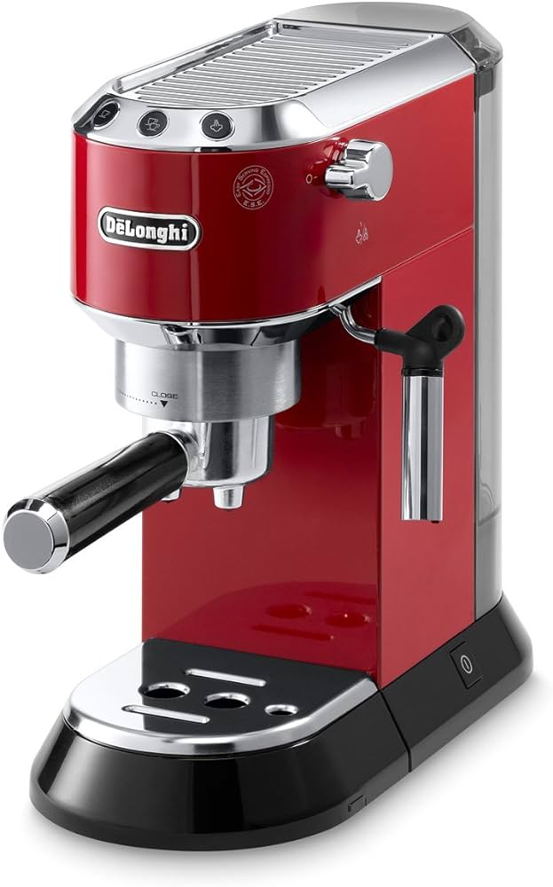
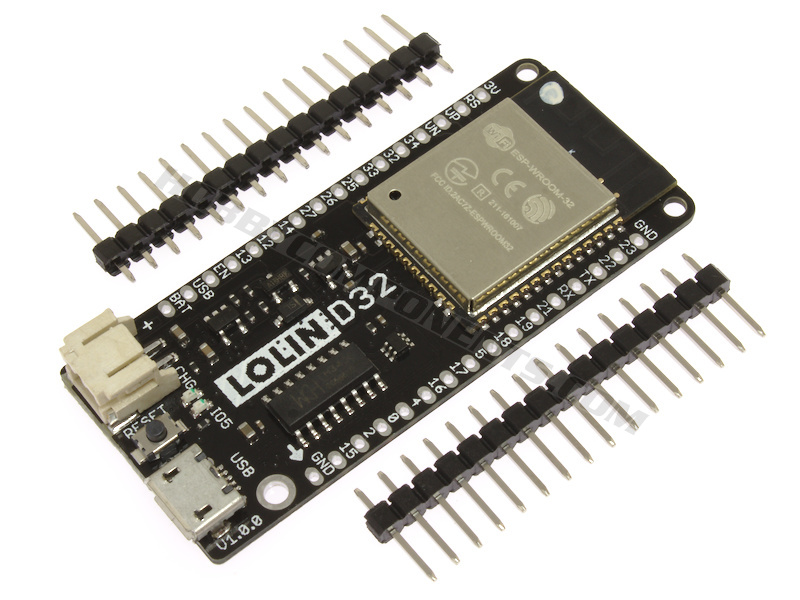
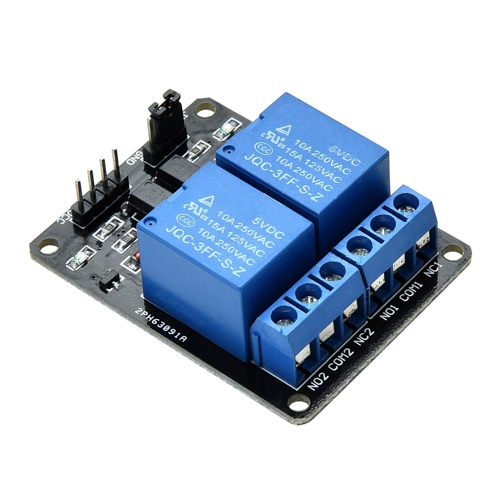
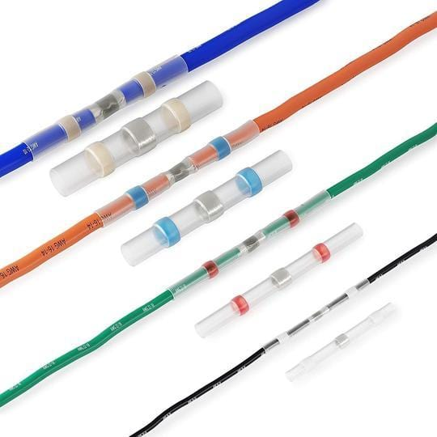

The Problem

The Dedica needs time to warm up and my method requires a second button press. Both of these things take time, so I found that automating it was interesting. The first button press from Home Assistant wakes the machine, the second makes the first part of my coffee, and the third completes the process. Then later when it's time for the next cup I repeat.

The Approach

ESP32 with esphome, Homeassistant.

The Hardware

In previous versions I used the relay board because my partner wanted both the 'single drop' and 'double drop' buttons to be operated. That was very clunky. I since designed a circuit board with 2 transistors to close the circuit to press the buttons. Much smaller and easier.

Delonghi Dedica EC680M

ESP32, ESP8266, Arduino, Raspberry Pi, or any device with GPIOs
- I used a Lolin D32 like this:

Relay module
- I used a generic relay module like this:

Waterproof butt connectors

